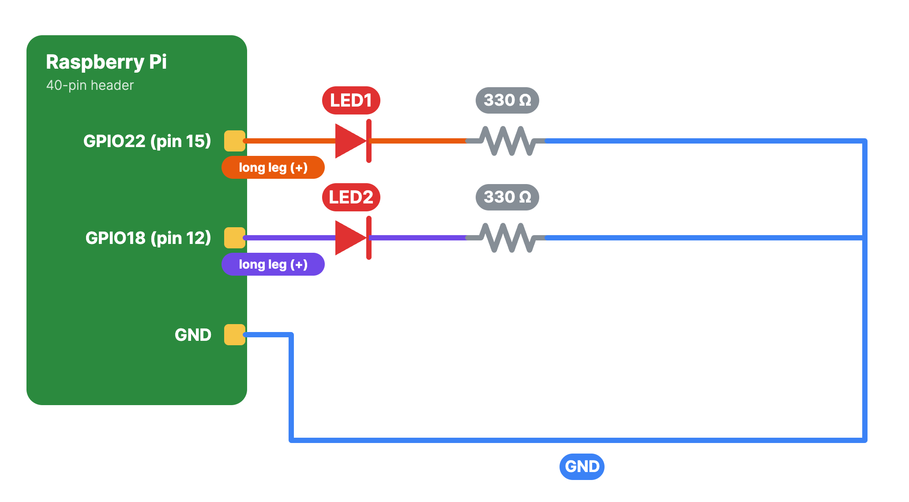

# Q1 – guizero: On/Off buttons for LED1, slider for LED2

- **On** turns LED1 on and **Off** turns it off. Each button greys out when it has nothing to do.
- Sliding the slider changes LED2's brightness (0 = off, 100 = full).

## Wiring

| From | To |
|---|---|
| GPIO22 (pin 15) | LED1 long leg (+) |
| LED1 short leg | 330 Ω → GND |
| GPIO18 (pin 12) | LED2 long leg (+) |
| LED2 short leg | 330 Ω → GND (any GND pin: 6, 9, 14, 20 …) |

## Run

Open `Q1_GUI_Buttons_Slider.py` in Thonny on the Pi and click **Run**, or run `python3 Q1_GUI_Buttons_Slider.py`. Use the Pi desktop (VNC), because guizero opens a window.

## How it works

- `LED(22)` is on/off only; `PWMLED(18)` takes a brightness from `0.0` to `1.0`.
- The slider gives `0–100`, so `led2.value = int(percent) / 100`. This is the same idea as Lecture 8, Example 7.
- `PushButton(..., command=led1_on)` passes the function itself. Writing `led1_on()` would run it once at start-up instead.

## Demo checklist

1. Show the circuit: both LEDs, both resistors, and the pins used.
2. Show the window with On, Off and the slider.
3. Press **On**: LED1 lights. Press **Off**: LED1 goes dark.
4. Slide from 0 to 100: LED2 goes from off to full brightness.
