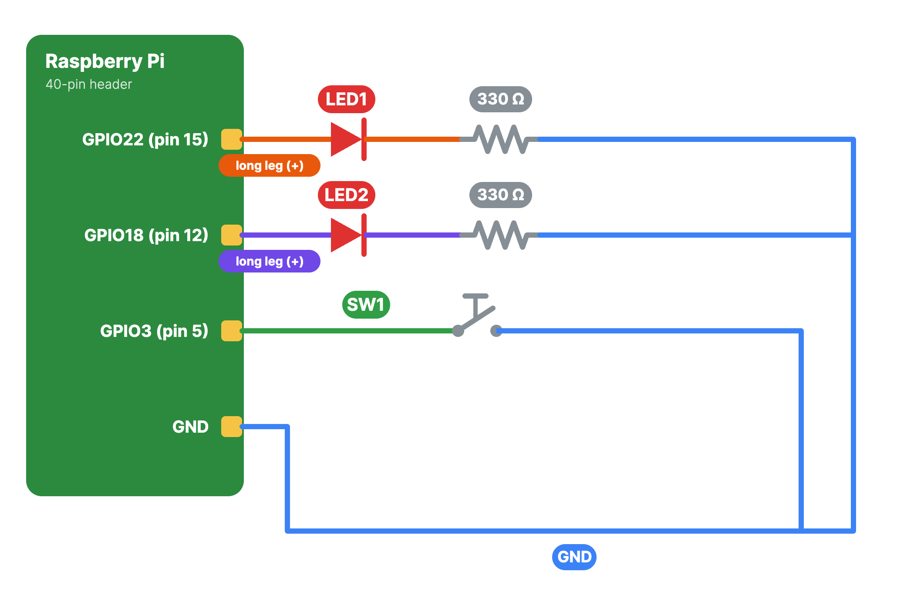

# Q2 – Node-RED: SW1 controls LED1, dashboard slider controls LED2

- **SW1:** pressing it turns **LED1 off**; otherwise LED1 is on.
- **Dashboard slider:** sets **LED2** brightness.

## Wiring



| From | To |
|---|---|
| GPIO22 (pin 15) | LED1 long leg → 330 Ω → GND |
| GPIO18 (pin 12) | LED2 long leg → 330 Ω → GND |
| GPIO3 (pin 5) | SW1 → GND. No resistor is needed, because the internal pull-up is used. |

## Flow

```
SW1 (rpi-gpio in, GPIO3, pull-up) ──▶ LED1 (rpi-gpio out, GPIO22, Digital output)
slider (dashboard, 0–100)         ──▶ LED2 (rpi-gpio out, GPIO18, PWM output, 100 Hz)
```

1. Install `node-red-dashboard` once, from Manage palette.
2. Go to Main menu → **Import**, paste [`flow.json`](flow.json), click Import, then **Deploy**.
3. Open the dashboard at `http://<Pi IP>:1880/ui` (tab **Exam**, group **LED2**).

## Why pressing turns LED1 off with no extra node

The pull-up holds GPIO3 **HIGH (1)** when the switch is open, and pressing connects it to GND, which is **LOW (0)**. Since SW1 is wired straight to LED1, the LED follows: pressed is 0, so it's off; not pressed is 1, so it's on. That's exactly what the question asks. This is the same as Lecture 9, Example 4.

The slider sends 0–100, which is exactly the range a **PWM output** node accepts. This is the same as Lecture 9, Example 3.

## Demo checklist

1. Show the circuit, then a screenshot of the flow with **all nodes** visible. The statuses under the gpio nodes show `1` and `OK`.
2. Show the slider on the `/ui` dashboard.
3. Press and hold SW1: LED1 goes off. Release it: LED1 is back on.
4. Move the slider: LED2's brightness changes.

**Tip:** disable any other tab that uses GPIO18, GPIO22 or GPIO3 before you Deploy.
