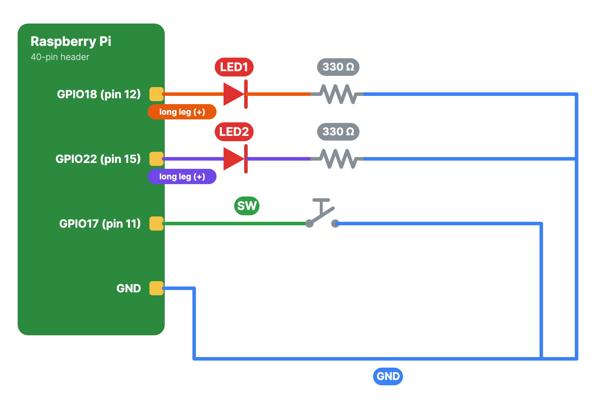

# Question 1 (17 points) – slider bar for LED1, switch SW for LED2

- **Slider bar widget:** sets **LED1's brightness**. 0 turns LED1 off; moving it up turns LED1 on and makes it brighter.
- **Switch SW pressed:** **LED2 off**. **Not pressed:** **LED2 on**.

## Wiring

The question allows any pins. These are the ones used in `A1.py`:



| From | To |
|---|---|
| GPIO18 (pin 12) | LED1 long leg (+); short leg → 330 Ω → GND |
| GPIO22 (pin 15) | LED2 long leg (+); short leg → 330 Ω → GND |
| GPIO17 (pin 11) | SW → GND. No resistor is needed, because the internal pull-up is used. |
| GND (pin 6, 9, 14 …) | GND rail on the breadboard |

## A1: the Python program

[`A1.py`](A1.py). Copy it to the Pi, open it in **Thonny** on the Pi desktop (VNC), and click **Run**. guizero needs a desktop window, so it won't work over plain SSH.

```python
led1 = PWMLED(18)               # brightness 0.0 - 1.0
led2 = LED(22)                  # on / off
sw = Button(17, pull_up=True)   # pressed = connected to GND

sw.when_pressed = led2.off      # pressed     -> LED2 off
sw.when_released = led2.on      # not pressed -> LED2 on

def slider_changed(value):
    led1.value = int(value) / 100   # slider 0-100 -> 0.0-1.0
```

- **`PWMLED`** is needed for brightness. A plain `LED` can only be on or off.
- **Why the switch logic works:** the pull-up holds GPIO17 HIGH while SW is open. Pressing connects it to GND, and gpiozero counts that as "pressed".
- **`if sw.is_pressed:` at start-up** sets LED2 correctly before the switch is touched for the first time.
- **Pass the function itself:** write `command=slider_changed` and `led2.off`, without `()`.

## A2: the video checklist

1. **Circuit (4 pts):** show both LEDs, both 330 Ω resistors, the switch, and which Pi pins they use.
2. **Slider bar widget (3 pts):** show the window titled "Slider bar for LED1".
3. **Demonstration (8 pts):**
   - Move the slider to **0**: LED1 turns **off**.
   - Move the slider up: LED1 turns **on** and gets brighter.
   - **Press** SW: LED2 turns **off**.
   - **Release** SW: LED2 turns **on**.

**Troubleshooting:**
- **`GPIO busy`:** another program, or a Node-RED flow, is using the same pin. Stop it or disable that Node-RED tab.
- **LED2 is the wrong way round:** check that SW goes to **GND**, not 3.3 V.
