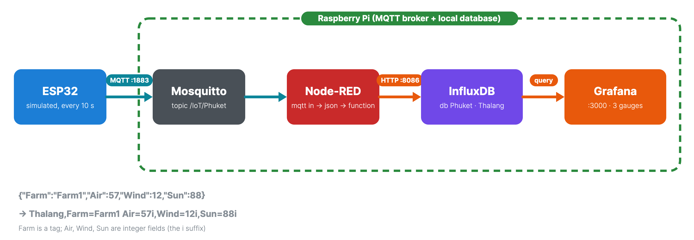

# Question 2 (18 points) – ESP32 → MQTT → Node-RED → InfluxDB → Grafana

The ESP32 sends `{"Farm":"Farm1","Air":…,"Wind":…,"Sun":…}` over MQTT **every 10 s**. Node-RED stores each message in the **`Thalang`** measurement of the **`Phuket`** database with the **`influxdb out`** node, and a Grafana dashboard shows **Air, Wind and Sun** on **3 gauges**.

> **2.3 (the ESP32 sketch) was cancelled.** To be done: **2.1, 2.2 and 2.4**. The sketch is still here as **optional**. It's the easiest way to feed data into 2.2 and 2.4, or use `mosquitto_pub` from the terminal instead (see [2.2](#22-b2-b3-node-red-flow)).



There is no circuit. The ESP32 only needs USB power and the same Wi-Fi as the Pi.

| File | For |
|---|---|
| [`B1_influx_commands.txt`](B1_influx_commands.txt) | 2.1: create the database and insert 4 rows |
| [`B2_flow.json`](B2_flow.json) | 2.2: the Node-RED flow (import it) |
| [`B3_function_node.js`](B3_function_node.js) | 2.2: the function node code |
| [`B4_ESP32_Thalang/B4_ESP32_Thalang.ino`](B4_ESP32_Thalang/B4_ESP32_Thalang.ino) | 2.3 (optional): the ESP32 sketch |
| [`B5_grafana_thalang_dashboard.json`](B5_grafana_thalang_dashboard.json) | 2.4: the Grafana dashboard with 3 gauges (import it) |

## 2.1 (B1): InfluxDB database `Phuket`, measurement `Thalang`

```sql
influx
create database Phuket
use Phuket
insert Thalang,Farm=Farm1 Air=25,Wind=60,Sun=80
insert Thalang,Farm=Farm1 Air=42,Wind=15,Sun=95
insert Thalang,Farm=Farm1 Air=7,Wind=88,Sun=33
insert Thalang,Farm=Farm1 Air=63,Wind=41,Sun=12
select * from Thalang
```

```
insert Thalang,Farm=Farm1 Air=25,Wind=60,Sun=80
       └measurement┘└tag─────┘ └──── fields ─────┘
```

- **`Farm`** is a **tag**, because it sits before the space.
- **`Air`, `Wind` and `Sun`** are **fields**, and the values are whole numbers from 0–100.
- **Spaces:** exactly one after `insert`, and one between the tag and the fields. Don't put spaces after commas.
- **Wait about 2 s between inserts,** so each row gets its own timestamp.
- **For the B1 photo:** `select * from Thalang` must show at least 4 rows.

> **Why no `i` suffix?** `Air=25i` would store an *integer* field. But Node-RED's `influxdb out` node (2.2) **always writes numbers as floats** on InfluxDB 1.x; the `'25i'` string trick only works with InfluxDB 1.8-flux or 2.0. A field can't be integer in some rows and float in others, so with `i` rows already in `Thalang`, every write from Node-RED fails with `field type conflict … is type float, already exists as type integer`. Inserting without `i` keeps all rows float, so 2.1 and 2.2 share the same measurement. Check with `show field keys from Thalang`: it lists `Air float`, `Sun float` and `Wind float`.
>
> **If you already inserted rows with `i`:** run `drop measurement Thalang`, then insert them again without `i`.

## 2.2 (B2, B3): Node-RED flow

```
mqtt in /IoT/Phuket → json → function "Fields" → influxdb out "Thalang" (database Phuket)
```

1. Main menu → **Import** → paste [`B2_flow.json`](B2_flow.json) → Import → **Deploy**. It opens as a new tab.
2. Check the settings:

   | Node | Setting |
   |---|---|
   | mqtt in | topic `/IoT/Phuket`, output auto-detect; broker **Local Pi** = `192.168.2.2:1883` |
   | json | convert `msg.payload` to a JavaScript object |
   | function **Fields** | see below |
   | influxdb out | server **Phuket**: host `localhost`, port `8086`, database `Phuket`, version 1.x; measurement `Thalang` |

   The broker address `192.168.2.2` is the Pi's own cable IP. If the Pi's IP changes, for example on Wi-Fi, set it to **`localhost`**, which always means "this Pi".
3. Wait until the **mqtt in** node shows **connected**, then send data with the ESP32 (2.3), or from a Pi terminal:
   ```bash
   mosquitto_pub -h localhost -t /IoT/Phuket -m '{"Farm":"Farm1","Air":30,"Wind":70,"Sun":55}'
   ```
4. Check that it was saved: `influx -database Phuket -execute "select * from Thalang order by time desc limit 3"`. The newest row should show the values you just sent.

**B3, the function node "Fields"** (open it and take the photo of this setup):

```javascript
msg.payload = [{
    Air: msg.payload.Air,
    Wind: msg.payload.Wind,
    Sun: msg.payload.Sun
},
{
    Farm: msg.payload.Farm
}];

return msg;
```

`influxdb out` takes an array: **the first object is the fields, the second is the tags**. So `{"Farm":"Farm1","Air":57,"Wind":12,"Sun":88}` is stored like `insert Thalang,Farm=Farm1 Air=57,Wind=12,Sun=88`. This is the same pattern as Lecture 11, Example 3.

| Problem | Fix |
|---|---|
| mqtt in **disconnected** | Mosquitto isn't running (`sudo systemctl restart mosquitto`), or the broker address is wrong; use `localhost` |
| red error `field type conflict` on influxdb out | `Thalang` still has `i` (integer) rows: `drop measurement Thalang` and redo 2.1 without `i` |
| red error `database not found` | run `create database Phuket` in `influx` |
| nothing happens | the tab is disabled (double-click the tab → Enabled), or nothing is being published |

## 2.3 (optional, B4): ESP32 sketch

2.3 was cancelled, so this part is **optional**. It's still the most realistic way to send data every 10 s for 2.2 and 2.4.

[`B4_ESP32_Thalang.ino`](B4_ESP32_Thalang/B4_ESP32_Thalang.ino) is based on Lecture 11's `Home_Sensors_PubNode_JSON.ino`, and it compiles for the **ESP32 Dev Module**. Every 10 s it sends `{"Farm":"Farm1","Air":…,"Wind":…,"Sun":…}`, with random integers from 0–100, to `/IoT/Phuket`.

1. **Put the Pi on the same network the ESP32 can reach,** then use the Pi's IP as `mqtt_server`. Find it with `hostname -I` on the Pi, or `./pi.sh ip`. On Wi-Fi this is the Pi's **Wi-Fi IP**; a phone hotspot works well.
2. **In the sketch,** set `ssid`, `password` and `mqtt_server`. Upload it, then open the **Serial Monitor at 115200**:
   ```
   Attempting MQTT connection...connected
   Sent to Pi: {"Farm":"Farm1","Air":57,"Wind":12,"Sun":88}
   ```
   "Sent to Pi" prints only when `publish()` succeeded, which is what the B4 photo would show.
3. **Check that it arrived:** `select * from Thalang order by time desc limit 3` shows the ESP32's values, with a new row about every 10 s.

| Serial Monitor shows | Fix |
|---|---|
| dots forever, no "Connected" | wrong `ssid`/`password`, or the network is 5 GHz only (the ESP32 needs 2.4 GHz) |
| `failed, rc=-2` | can't reach the Pi: wrong IP, or not on the same network |
| `failed, rc=5` | Mosquitto needs `allow_anonymous true` (Lecture 10) |

- **`random(101)`** gives 0–100. `random(100)` would stop at 99.
- **`randomSeed(esp_random())`** makes the values different after every reset.

## 2.4 (B5): Grafana dashboard with 3 gauges

1. **Add a data source for `Phuket`:** Connections → Add new connection → **InfluxDB**. Name it `InfluxDB-Phuket`.

   | Setting | Value |
   |---|---|
   | URL | `http://localhost:8086` |
   | Database | **`Phuket`** |
   | User / Password | `InfluxUser` / `InfluxPW` |
   | HTTP Method | POST |

   Click **Save & test**. You need a separate data source, because the Lecture 11 one points to `InfluxTest`.
2. **Quickest way:** Dashboards → New → **Import** → upload [`B5_grafana_thalang_dashboard.json`](B5_grafana_thalang_dashboard.json) → pick `InfluxDB-Phuket` → **Import**.
3. **By hand:** create 3 **Gauge** panels, one each for Air, Wind and Sun.

   | Panel | FROM | WHERE | SELECT |
   |---|---|---|---|
   | Air | `Thalang` | `Farm = Farm1` | `field(Air)` `last()` |
   | Wind | `Thalang` | `Farm = Farm1` | `field(Wind)` `last()` |
   | Sun | `Thalang` | `Farm = Farm1` | `field(Sun)` `last()` |

   Set Min **0**, Max **100**, time range **Last 24 hours**, and refresh **5s**. Save the dashboard as **Thalang**.

**B5 video:** in a terminal, show the latest rows:
```sql
use Phuket
select * from Thalang order by time desc limit 5
```
Then switch to the dashboard and show that the three gauges match the newest row. Wait about 10 s so the ESP32 sends a new message (or run the `mosquitto_pub` command again), then show the gauges change and the new row in `select`.

- **"No data":** the panel is using the `InfluxTest` data source, or the time range doesn't include your rows. The `insert` rows from 2.1 count too, so Last 24 hours is enough.
