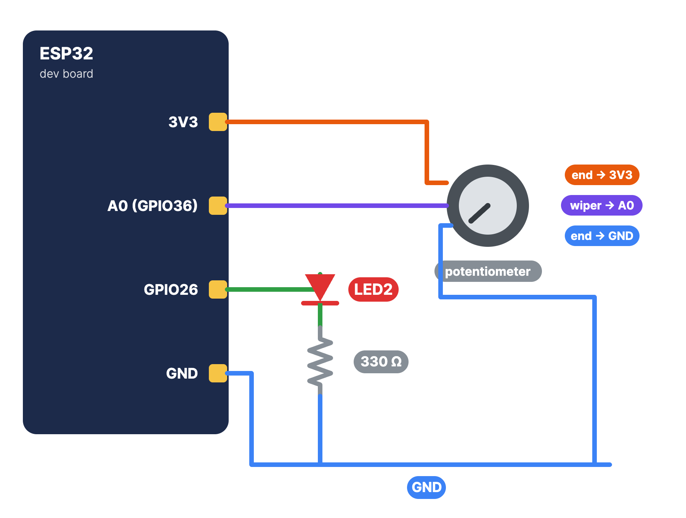
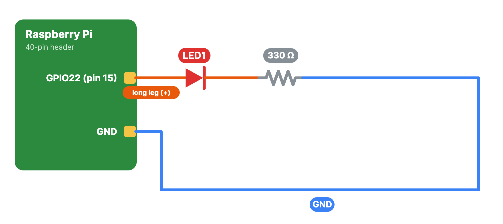

# Lecture 10 – Raspberry Pi: Local MQTT Broker & SQL Database

## Arduino sketches (ESP32)

Put your Wi-Fi SSID and password, and the Pi's IP from `hostname -I`, into the sketch before uploading.

| File | What it does |
|---|---|
| `Local_RaspberryPi_PubSub.ino` | Examples 1–2: publishes the potentiometer value (`/IoT/PotenValue`) and subscribes to the same topic. Above 500, LED2 on GPIO26 turns on. |
| `Local_NodeRed_PubNode.ino` | Example 6: publishes a random value to `/IoT/Test1` every 5 s |
| `Local_NodeRed_PubNode_JSON.ino` | Example 7: publishes `{"Sensor1":x,"Sensor2":y}` to `/IoT/Test2` |

## Pi setup (once)

```bash
sudo apt install mosquitto
sudo nano /etc/mosquitto/mosquitto.conf
```

Add these two lines at the end of `mosquitto.conf`, then restart Mosquitto:

```
listener 1883
allow_anonymous true
```

```bash
sudo systemctl restart mosquitto
```

In Node-RED (`http://<Pi IP>:1880`, login `pi` / `raspberry`), install `node-red-node-sqlite` and `node-red-dashboard` from **Manage palette**.

## Example 3: SQLite in the terminal (`Home1.db`)

No Node-RED and no wiring. This runs in the Pi's terminal.

```bash
sudo apt install sqlite3          # once; needs internet
cd /home/pi
sqlite3 Home1.db                  # creates Home1.db and opens the sqlite> shell
```

Then type these in the `sqlite>` shell:

```sql
CREATE TABLE Room1(id INTEGER PRIMARY KEY AUTOINCREMENT, date DATETIME, sensor1 REAL, sensor2 REAL, sensor3 REAL);
.tables
INSERT INTO Room1 (date, sensor1, sensor2, sensor3) VALUES (datetime("now"), 55, 29, 71);
SELECT * FROM Room1;
.quit
```

Real output from a Pi:

```
Room1
1|2026-11-13 13:23:39|55.0|29.0|71.0
```

- **`id`:** `INTEGER PRIMARY KEY AUTOINCREMENT` numbers the rows 1, 2, 3… by itself, which is why the INSERT doesn't give it.
- **`date`:** `datetime("now")` is **UTC**, so 13:23 here is 20:23 Thai time.
- **`REAL` columns:** store decimals, so `55` becomes `55.0`.
- **Dot-commands** (`.tables`, `.quit`, `.help`) are sqlite3 shell commands and take **no `;`**. SQL statements end with **`;`**.
- **Deleting:** remove a table with `DROP TABLE Room1;`. To delete the whole database, delete the file (`rm Home1.db`); there's no SQL command for it.
- **Running it in one go:** [`Example3_SQLite_Home1/example3.sql`](Example3_SQLite_Home1/example3.sql) has the same commands. Run `sqlite3 Home1.db < Example3_SQLite_Home1/example3.sql`.

## Node-RED flows

To use a flow, open **Main menu → Import**, paste the `flow.json`, then click **Deploy**.

| Folder | Flow |
|---|---|
| `Example2_Gauge_LED1` | `mqtt in /IoT/PotenValue_YOUR_ID` → `range` (0–4095 to 0–100) → LED1 PWM on GPIO22, and → a dashboard gauge at `/ui` |
| `Example4_Create_Table` | `inject` → `sqlite`: `create table SensorData (TheTime Timestamp, TheValue integer)` in `/home/pi/Database1`. Click inject once only. |
| `Example5_Insert` | inject `10` → function (`msg.params`) → prepared `insert into SensorData …` |
| `Example6_MQTT_to_SQLite` | `mqtt in /IoT/Test1_YOUR_ID` → function → insert into `SensorData` |
| `Example7_JSON_TwoSensors` | `mqtt in /IoT/Test2_YOUR_ID` → `json` → function → insert into `TwoSensors` in `/home/pi/Database2`. Create that table first: `create table TwoSensors(TheTime Timestamp, Sen1Val integer, Sen2Val integer);` |

## Troubleshooting: "Flows stopped due to missing node types: sqlitedb, sqlite"

This can happen even after installing `node-red-node-sqlite` from Manage palette. Check the Node-RED log on the Pi:

```bash
sudo journalctl -u nodered --no-pager -n 300 | grep -i sqlite
```

If it shows

```
Error: /lib/aarch64-linux-gnu/libm.so.6: version `GLIBC_2.38' not found (required by …/sqlite3/build/Release/node_sqlite3.node)
```

then npm downloaded a ready-made SQLite binary built for a newer Linux than the Pi runs. Raspberry Pi OS Bookworm has glibc 2.36, so Node-RED can't load it, and the nodes count as "missing" even though they are installed.

**Fix:** build SQLite on the Pi so it matches the Pi's own glibc. This takes about 5–15 minutes.

```bash
sudo apt update
sudo apt install -y build-essential python3 python3-setuptools
cd ~/.node-red
npm rebuild sqlite3 --build-from-source
node-red-restart
```

Refresh the editor afterwards. The warning disappears, and the sqlite nodes show a green **RWC** status after Deploy.

**Fallback if the build fails:** install the previous version, which ships a binary that works on Bookworm. The flows don't need any changes.

```bash
cd ~/.node-red
npm install node-red-node-sqlite@1.1.0
node-red-restart
```

**Removing the palette:** Manage palette refuses with "Type in use: sqlitedb, sqlite" while any flow still uses those nodes. You don't need to remove it to apply the fix above. To remove it anyway:

1. Delete every sqlite node (Ctrl/⌘ + F, search `sqlite`; disabled tabs count too).
2. Delete the `sqlitedb` entries under Main menu → Configuration nodes.
3. Deploy, then remove the palette.

## Notes

- **Topics:** change `YOUR_ID` in the topics so they match the topic in your sketch exactly.
- **Pin numbers:** the `pin` field is the **BCM GPIO number**, so LED1 is `22` (physical pin 15).
- **Tested on:** Node-RED 5.0.9 and Mosquitto on a Raspberry Pi 4, with MQTT test messages published from a laptop in place of the ESP32.

## Wiring (Examples 1–2, Exercise 7)

**ESP32:** potentiometer ends to 3V3 and GND, wiper to A0 (GPIO36/VP). LED2 on GPIO26 → 330 Ω → GND.



**Pi (Example 2):** LED1 on GPIO22 (pin 15) → 330 Ω → GND, driven by Node-RED `rpi-gpio out` (PWM).



Examples 4–7 need no wiring; the ESP32 sketches send random values.

*Wiring diagrams redrawn from the Peanut Cheat Sheets lecture videos (transparent PNG; the SVG sources are in each `wiring/` folder)*
