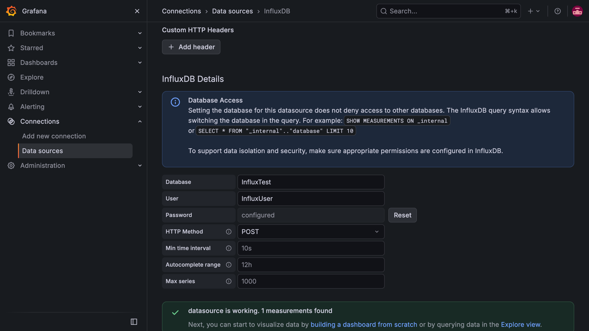
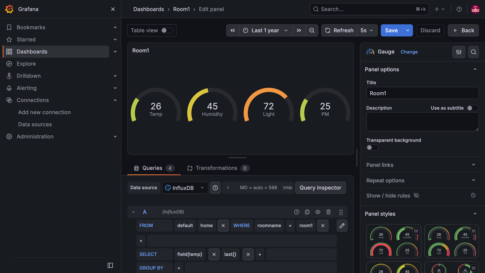
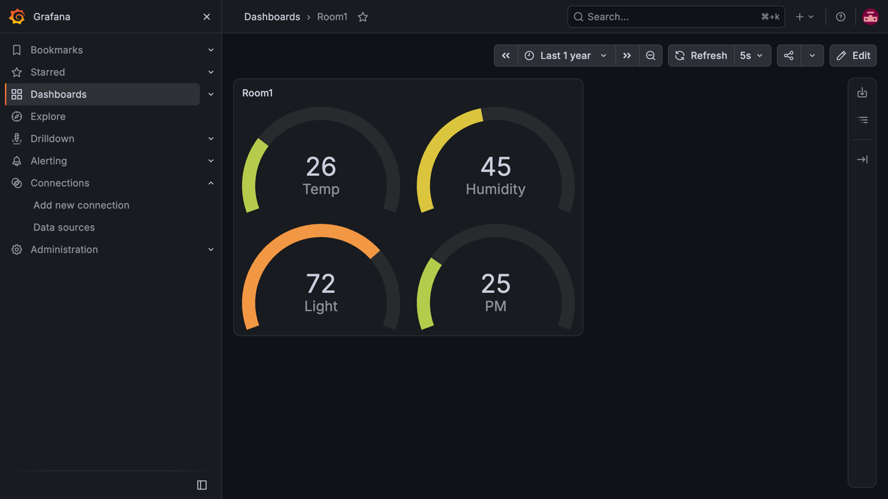
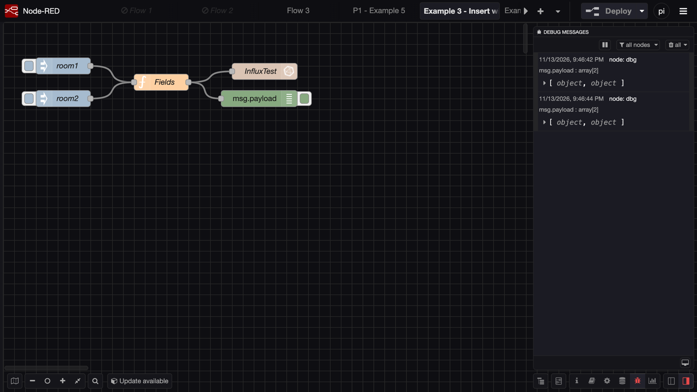

# Lecture 11 – Raspberry Pi: InfluxDB and Grafana

## Pi setup (once)

```bash
# InfluxDB v1
curl https://repos.influxdata.com/influxdata-archive.key | gpg --dearmor | sudo tee /usr/share/keyrings/influxdb-archive-keyring.gpg >/dev/null
echo "deb [signed-by=/usr/share/keyrings/influxdb-archive-keyring.gpg] https://repos.influxdata.com/debian stable main" | sudo tee /etc/apt/sources.list.d/influxdb.list
sudo apt update && sudo apt install influxdb
sudo systemctl unmask influxdb && sudo systemctl enable influxdb && sudo systemctl start influxdb
sudo nano /etc/influxdb/influxdb.conf      # under [http]: remove the # before "enabled = true"
sudo systemctl restart influxdb

# Grafana
sudo mkdir -p /etc/apt/keyrings/
wget -q -O - https://apt.grafana.com/gpg.key | gpg --dearmor | sudo tee /etc/apt/keyrings/grafana.gpg > /dev/null
echo "deb [signed-by=/etc/apt/keyrings/grafana.gpg] https://apt.grafana.com stable main" | sudo tee /etc/apt/sources.list.d/grafana.list
sudo apt-get update && sudo apt-get install -y grafana
sudo /bin/systemctl enable grafana-server && sudo /bin/systemctl start grafana-server
sudo grafana-cli admin reset-admin-password admin      # login admin / admin
```

Next, run `influx` and enter these InfluxQL commands:

```sql
create database InfluxTest
create user InfluxUser with password 'InfluxPW' with all privileges
grant all privileges on InfluxTest to InfluxUser
use InfluxTest
insert home,roomname=room1 temp=25,humid=50,light=65,pm=20
select * from home
```

Then set up Grafana at `http://<Pi IP>:3000`:

1. Add an InfluxDB data source: URL `http://localhost:8086`, database `InfluxTest`, user `InfluxUser` / `InfluxPW`, method POST.
2. Create a dashboard with 4 gauges. Each gauge queries `FROM home WHERE roomname = room1 SELECT field(temp) last()`, and likewise for humid, light and pm.

In Node-RED, install `node-red-contrib-influxdb` from **Manage palette**.

## Example 1: insert data in the InfluxDB shell (Exercise 8 P1)

Open the shell on the Pi and select the database:

```bash
influx
```
```sql
show databases
use InfluxTest
```

Insert rows with the **line protocol**. Add 4 or more rows for `room1` and 4 or more for `room2`, waiting at least 2 s between inserts so each row gets a clearly different timestamp:

```sql
insert home,roomname=room1 temp=25,humid=50,light=65,pm=20
insert home,roomname=room1 temp=26,humid=45,light=72,pm=25
insert home,roomname=room2 temp=15,humid=30,light=35,pm=19
insert home,roomname=room2 temp=18,humid=34,light=40,pm=22
select * from home
precision rfc3339
select * from home
quit
```

How to read an `insert` line:

```
insert home,roomname=room1 temp=25,humid=50,light=65,pm=20
       └─ measurement ─┘└tag┘ └───────── fields ──────────┘   (timestamp added automatically)
```

| Part | Here |
|---|---|
| measurement (like a table) | `home` |
| tag (indexed, used in `WHERE`) | `roomname=room1` |
| fields (the values) | `temp=25,humid=50,light=65,pm=20` |
| timestamp | added automatically, in nanoseconds |

- **Exactly two spaces:** one after `insert`, and one between the tags and the fields. Don't put a space after the commas; `temp=25, humid=50` breaks the line.
- **Plain numbers are stored as float.** Use `temp=25i` for an integer.
- **No `;`** in InfluxQL.

Real output from a Pi:

```
> select * from home
name: home
time                humid light pm roomname temp
----                ----- ----- -- -------- ----
1794581107598701987 50    65    20 room1    25
1794581109682196936 45    72    25 room1    26
1794581111692458413 30    35    19 room2    15
1794581115530971299 34    40    22 room2    18
> precision rfc3339
> select * from home
2026-11-13T14:45:07.598701987Z 50    65    20 room1    25
```

The default time is a 19-digit nanosecond count. `precision rfc3339` shows it as a readable UTC time.

## Example 2: Room1 and Room2 dashboards in Grafana (Exercise 8 P2)

1. Open `http://<Pi IP>:3000` and log in as **admin / admin**. When asked to change the password you can click **Skip**.

   

2. **Add the data source:** Connections → Add new connection → **InfluxDB**.

   | Setting | Value |
   |---|---|
   | URL | `http://localhost:8086` |
   | Database | `InfluxTest` |
   | User / Password | `InfluxUser` / `InfluxPW` |
   | HTTP Method | **POST** |
   | Default | on |

   Click **Save & test**. It should say "datasource is working".

   

3. **Build the Room1 dashboard:** Dashboards → New → Add visualization → visualization **Gauge**. Add 4 queries, clicking **+ Query** for each new one:

   | Query | FROM | WHERE | SELECT | Alias |
   |---|---|---|---|---|
   | A | `home` | `roomname = room1` | `field(temp)` `last()` | Temp |
   | B | `home` | `roomname = room1` | `field(humid)` `last()` | Humidity |
   | C | `home` | `roomname = room1` | `field(light)` `last()` | Light |
   | D | `home` | `roomname = room1` | `field(pm)` `last()` | PM |

   Then set the panel options: title **Room1**, Min **0**, Max **100**, and time range **Last 1 year**. Save the dashboard as **Room1** and set the refresh to **5s**.

   

4. **Make Room2:** open Room1 → **Save as** "Room2", then change each query's tag to `roomname = room2`.

   

- **`last()`** shows the newest row, so the gauges show the most recent insert.
- **"No data"?** The data-source URL probably has an old Pi IP; use `http://localhost:8086`. Also make sure the time range (Last 1 year) covers your rows.
- Grafana 13's menus are named a little differently from the slides, but the steps are the same.

## Example 3: insert data with Node-RED (HW8 P1)

1. Install **`node-red-contrib-influxdb`** from Manage palette. The InfluxDB nodes appear under **storage**.
2. Import [`Example3_Insert_with_NodeRED/flow.json`](Example3_Insert_with_NodeRED/flow.json), then Deploy.

```
inject room1 ─┐
              ├─▶ function "Fields" ─▶ influxdb out (InfluxTest, measurement home) ─▶ debug
inject room2 ─┘
```

| Node | Setting |
|---|---|
| inject **room1** | JSON `{"roomname":"room1","temp":20,"humid":50,"light":35,"pm":15}` |
| inject **room2** | JSON `{"roomname":"room2","temp":30,"humid":60,"light":45,"pm":25}` |
| function **Fields** | see below |
| influxdb out | Server: host `localhost`, port `8086`, database `InfluxTest`; Measurement: `home` |

```javascript
msg.payload = [{
    temp:msg.payload.temp,
    humid:msg.payload.humid,
    light:msg.payload.light,
    pm:msg.payload.pm
},
{
    roomname:msg.payload.roomname
}]
return msg;
```

The `influxdb out` node takes an array: **the first object is the fields, the second is the tags**. So this writes the same kind of point as Example 1's `insert home,roomname=room1 temp=20,humid=50,light=35,pm=15`.



3. Click the **room1** and **room2** injects. Then check either way:
   - In the `influx` shell: `use InfluxTest` → `select * from home`. The new rows appear at the end.
   - Open the Room1 and Room2 dashboards. The gauges jump to 20/50/35/15 and 30/60/45/25.

   

## Files

| File | What it is |
|---|---|
| `Home_Sensors_PubNode_JSON.ino` | ESP32 sketch. Publishes `{"roomname":"room1","temp":..,"humid":..,"light":..,"pm":..}` to `/IoT/HomeSensors` every few seconds. Put your SSID, password and the Pi's IP in the sketch. |
| `Example3_Insert_with_NodeRED/flow.json` | inject (room1/room2 JSON) → `Fields` function → `influxdb out` (measurement `home`) |
| `Example4_ESP32_JSON_to_InfluxDB/flow.json` | `mqtt in /IoT/HomeSensors` → `json` → `Fields` → `influxdb out`. Grafana's Room1 dashboard then updates live. |

For Example 5 (Room2), use the same flow and change `"room1"` to `"room2"` in the sketch.

The `Fields` function sends `[fields, tags]`, which `influxdb out` writes as one point:

```javascript
msg.payload = [{temp:msg.payload.temp, humid:msg.payload.humid, light:msg.payload.light, pm:msg.payload.pm},
               {roomname:msg.payload.roomname}];
return msg;
```

**Tested on:** InfluxDB 1.13.2, Grafana 13.3.1 and Node-RED 5.0.9 on a Raspberry Pi 4, with MQTT test messages published from a laptop in place of the ESP32.

## Wiring

None. `Home_Sensors_PubNode_JSON.ino` sends random temp, humid, light and pm values, so the ESP32 only needs USB power and the same Wi-Fi as the Pi.
