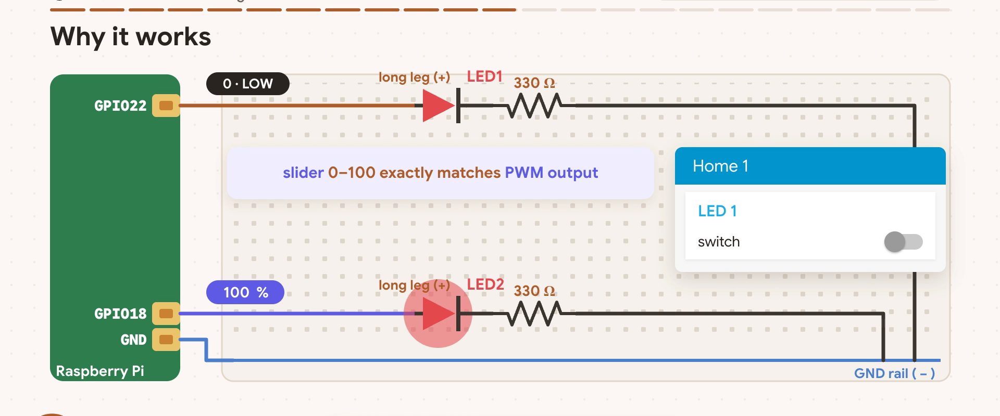
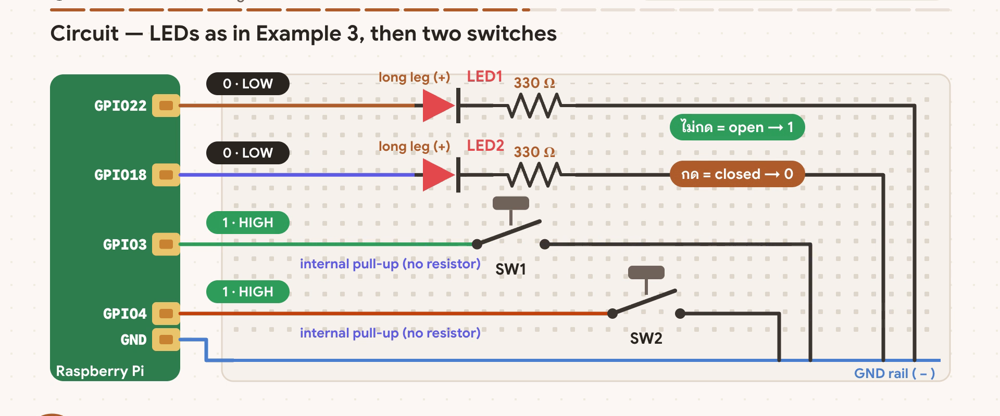
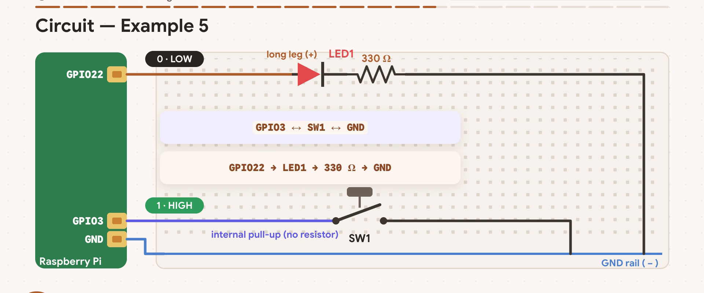

# Lecture 9 – Raspberry Pi: Node-RED

Each folder has a `flow.json`. To use one, open the Node-RED editor at `http://<Pi IP>:1880` and choose **Main menu → Import**. Paste the file's contents, click **Import**, then **Deploy**.

| Folder | What it does | Needs |
|---|---|---|
| `Example1_Inject_Debug` | Clicking the inject node sends "Hello" to the debug sidebar | – |
| `Example2_Hello_Dashboard` | Inject sends "Hello" to a dashboard `text` widget (Tab "Sensor 1", Group "Home 1"); open it at `/ui` | `node-red-dashboard` |
| `Example3_Switch_Slider_LEDs` | A dashboard switch turns LED1 on and off. A slider (0–100) sets LED2's brightness by PWM at 100 Hz. | `node-red-dashboard` |
| `Example4_Switches_LEDs` | SW1 and SW2 use the internal pull-up. Pressing a switch turns its LED **off**. | – |
| `Example5_MQTT_Switch_LED` | SW1 publishes to HiveMQ (`broker.hivemq.com:1883`, QoS 2). The same Pi subscribes and drives LED1. | internet |

## Wiring

| Part | Pin | Connection |
|---|---|---|
| SW1 | pin 5 (GPIO3) | to GND |
| SW2 | pin 7 (GPIO4) | to GND |
| LED1 | pin 15 (GPIO22) | to LED, then 330 Ω, then GND |
| LED2 | pin 12 (GPIO18) | to LED, then 330 Ω, then GND |

## Notes

- **Example 5 topic:** change `YOUR_ID` in the topic of **both** MQTT nodes to something unique. Anyone can publish to a public broker.
- **Pressed reads 0:** the switch uses a pull-up, so pressing it reads 0 and turns the LED off. To make pressing turn the LED **on**, add a `function` node: `msg.payload = 1 - Number(msg.payload); return msg;`.
- **Pin numbers:** the `pin` field in these flows is the **BCM GPIO number** (3, 4, 22, 18), which is what `node-red-node-pi-gpio` stores in Node-RED 5. In the editor you pick the pin from the header picture. If an import shows the wrong pin, double-click the gpio node and pick it again.
- **Tested on:** Node-RED 5.0.9 on a Raspberry Pi 4, with `node-red-node-pi-gpio` and `node-red-dashboard`.

## Wiring pictures

**Example 3 / HW6-P2:** LED1 on GPIO22 (pin 15) and LED2 on GPIO18 (pin 12), each through 330 Ω to GND.

**Example 4 / Exercise 6:** the same two LEDs, plus SW1 GPIO3 (pin 5) → GND and SW2 GPIO4 (pin 7) → GND, using the internal pull-up.

**Example 5 / HW6-P3:** LED1 on GPIO22, plus SW1 GPIO3 → GND.

Examples 1 and 2 need no wiring.

*Wiring pictures are frames from the Peanut Cheat Sheets lecture videos.*
